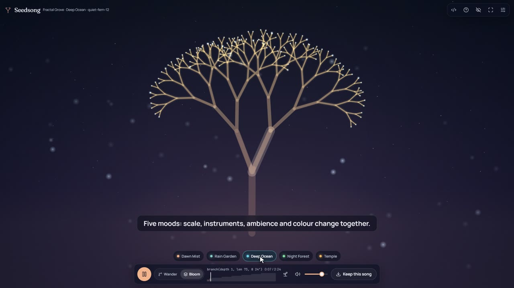
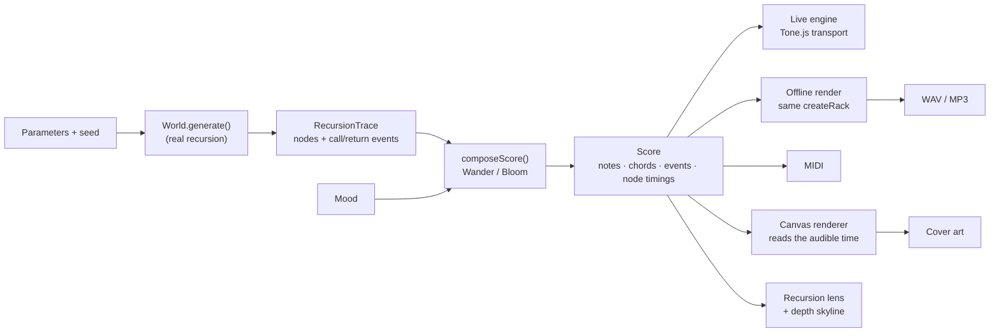

<div align="center">

# Seedsong

**Plant a seed. Watch recursion grow. Listen to it bloom.**

A calm browser “sound garden” for Hub’s Quest Epoch 1 · *Recursive Soundscapes*.
A recursive function grows a glowing tree, and the **call tree itself becomes the music**: every call is a note, every leaf (base case) rings a bell, and every return resolves a phrase.

**Live demo:** https://tawfiquehasan.github.io/seedsong/ · **Demo video (2:56):** https://tawfiquehasan.github.io/seedsong/seedsong-demo.mp4

<a href="https://tawfiquehasan.github.io/seedsong/seedsong-demo.mp4"></a>

*Click the picture to watch the narrated demo (plays in the browser). Also attached to the [v1.0.0 release](https://github.com/TawfiqueHasan/seedsong/releases/tag/v1.0.0).*

</div>

---

## The idea

Most “math music” maps numbers to random pitches. Seedsong maps **the shape of the recursion** to **the shape of the music**. A tree already has the structure of a piece: one root, a few big sections, many small phrases, and endings. So each level of `branch()` gets a musical job, and each `return` resolves what its call started.

| Recursion | Music | What you hear |
| --- | --- | --- |
| Trunk (the first call, depth 0) | The key | a root + fifth drone under the whole piece |
| Boughs (depth 1) | Sections | the melody moves to a new register |
| Depth-2 calls | Phrases | each phrase gets one chord from the mood’s progression, voice-led |
| Inner branches | Melody | longer branches play longer notes; left steps down, right climbs |
| Twigs (max depth − 1) | Ornaments | quieter, higher grace notes |
| Leaves (the **base case**) | Bells | chord tones an octave up; a blossom opens on the tree |
| Return from a phrase | Cadence | one beat of rest while the pad swells |
| Return from the root | Ending | the home chord and a long tail |

Other properties map too: branch **length → note length and loudness**, branch **angle → melodic step**, branch **x position → stereo pan**, **depth → register and softness**, and the **seed → the whole piece** (same seed, same song).

Two ways to walk the same tree, one toggle:

- **Wander (depth-first):** the melody climbs one branch to its leaf, returns, and climbs the next, like an improvisation that keeps coming home.
- **Bloom (breadth-first):** each level plays as one phrase, left to right like a harp sweep, so the tree blooms from drone to bells.

Hearing the difference teaches DFS vs BFS faster than any diagram. Even the harp sound is recursive: it is a Karplus–Strong pluck, a feedback loop.

## The six mandatory deliverables

| # | Deliverable | Where it lives |
| --- | --- | --- |
| 1 | Recursive algorithm with configurable parameters | **Fractal Grove** `branch(x, y, angle, length, depth)` (`src/core/worlds/grove.ts`): depth, branches, spread, taper, wind, lean, seed. **L-System Garden** `grow(symbol, depth)` (`src/core/worlds/lsystem.ts`): six plants, generations, bend, wind, lean. Drawer → *World* tab. |
| 2 | Interactive simulation / visualization | Canvas renderer (`src/viz/renderer.ts`): the tree grows branch by branch in sync with its notes, blossoms open when their bell rings, wind sway, fireflies. Plus the **recursion lens** (live call stack, counters, running line of code) and the **depth skyline** timeline you can click to seek. |
| 3 | Procedural music from the recursive process | Composer (`src/core/music/compose.ts`): pure, deterministic `RecursionTrace → Score` with scale lock, voice-leading, cadences on returns, density cap, Wander and Bloom. |
| 4 | UI with parameter controls and audio playback | Play/pause, seek, volume, mute, five mood presets, Wander/Bloom, new seed, drawer with World / Sound / Atmosphere / Session tabs, keyboard shortcuts. |
| 5 | Working audio export | **Keep this song**: WAV (16- or 24-bit, offline-rendered with the same instruments, dithered, peak-normalised, metadata with the share link), MP3 (192 kbps, Web Worker), MIDI (one track per voice), and 1600×1600 cover art. Real progress bar. |
| 6 | Polished, accessible, relaxing experience | One-tap Begin ritual, five moods with 3 s crossfades, procedural ambience mixer, breathing companion, sleep timer, zen mode, endless garden, reduced-motion mode, WCAG 2.2 AA checks (axe: 0 serious/critical). |

## Features by rubric line

**Relaxation & UX (35%)**: a first minute designed as a ritual (headphones hint → one *Begin* → drone fades in over 6 s → the trunk grows). Nothing startles: every start, stop, seek and regenerate is ramped (dip-crossfades, 400 ms debounce on sliders). Breathing companion (4 s in, 6 s out), sleep timer (15/30/60 min with a 60 s fade), zen mode, endless garden, eight procedural ambience layers (rain, ocean, wind, stream, crickets, birds, fire, chimes). Calm copy, no exclamation marks. Works on phones (bottom-sheet drawer, 44 px targets).

**Musical quality (25%)**: every melody note is computed in scale degrees, so out-of-key notes are impossible by construction. Chords move every phrase and are voice-led for the smallest movement. Phrases breathe (cadence + rest on each depth-2 return), the piece ends on the tonic with a tail. Density is capped (≤ 3.5 attacked notes in any second). Seeded humanisation (±12–20 ms, ±8% velocity). A real mix: high-passed voices, one long convolution reverb on a send, dotted-eighth delay, EQ → compressor → makeup → limiter at −1 dB. `npm run audio:qa` renders every mood and mode and checks the result (see below).

**Creative use of recursion (15%)**: the call tree *is* the form; the lens shows the live call stack and highlights the running line of code (call → note, base case → bell, return → resolution); the depth skyline shows the recursion’s shape over time; Wander vs Bloom; two different recursions (a branching function and a recursive grammar rewrite).

**Visual design (10%)**: one token system (“Nocturne Garden”: ink-navy sky, glass panels, Fraunces / Manrope / JetBrains Mono), a palette per mood that crossfades with the music, bioluminescent branches (trunk → tip gradient + additive glow), blossoms and sparks on bells, 60 fps Canvas 2D with batched paths.

**Interaction & usability (10%)**: plain-language help under every slider (“Depth: how many times each branch splits. Deeper trees make longer songs.”), presets first and parameters on request, shortcuts (Space, N, W, L, Z, E, M, ←/→, ↑/↓, 1–5, ?), share links that regrow the exact song, a local garden of saved seeds, gentle toasts and a *Replant* error screen.

**Technical execution (5%)**: pure, tested core; one rack for live and offline; unit + end-to-end + accessibility tests; audio QA; CI and GitHub Pages deploy workflows; 181 KB gzipped JS.

## How it works



- `src/core/**` is pure TypeScript (no DOM, no Tone, no React) and deterministic for a given (params, seed). Randomness only comes from a seeded PRNG (`cyrb128` → `sfc32`).
- `src/audio/rack.ts` has **one** `createRack()` used by live playback **and** by the offline export, so the file sounds like what you heard.
- The visuals never schedule audio. Each frame reads the audible transport time and derives what has grown and what is sounding from the Score, so sight and sound cannot drift (and seeking just works).

```
src/
  core/      random.ts, url.ts (share links)
    worlds/  types.ts, grove.ts, lsystem.ts, registry.ts
    music/   theory.ts, moods.ts, score.ts, compose.ts (+ core.test.ts)
  audio/     rack.ts, engine.ts, schedule.ts
  export/    offline.ts, wav.ts, mp3.ts + mp3.worker.ts, midi.ts, cover.ts, download.ts
  viz/       renderer.ts, color.ts
  ui/        components/ (Landing, TopBar, Dock, Drawer, Lens, KeepDialog, HelpDialog, Breathing, Toasts, Modal), hooks.ts
  state/     store.ts (Zustand)
  app/       App.tsx, controller.ts, ErrorBoundary.tsx
tests/e2e/   smoke, export, a11y (Playwright + axe)
scripts/     audio-qa.mjs, collect-ai-logs.mjs
```

## Run it

Requires Node.js 22+.

```bash
npm install
npm run dev          # http://localhost:5173
npm run verify       # typecheck + lint + unit tests + build
npm run test:e2e     # Playwright: smoke, keyboard, export, accessibility (uses Microsoft Edge locally)
npm run audio:qa     # renders every mood × mode offline and checks the mix
npm run build        # static site in dist/ (relative base, works on any GitHub Pages path)
```

**Deploy:** push to `main` on GitHub, then *Settings → Pages → Source: GitHub Actions*. `.github/workflows/deploy.yml` builds and publishes; `ci.yml` runs verify + e2e.

## Quality evidence

Measured on this build:

- Unit tests: 24 passing (determinism, node counts, call/return nesting, scale lock for every mood and mode, density cap, tonic ending, length budget, share links). The largest tree (2,047 nodes) generates and composes in about 8 ms.
- End-to-end: Begin → plays with no console errors (desktop and phone viewports); keyboard shortcuts; a real WAV download (about 10.6 MB, RMS −17 dBFS); axe on every screen state with 0 serious/critical violations.
- Audio QA (`npm run audio:qa`), reference seed `still-lake-07`, all five moods × both modes: peaks −3.6 to −5.8 dBFS (no clipping), RMS about −19 to −20 dBFS live, about −15 to −16.5 dBFS after export normalisation (target −18 to −16 LUFS), no silence longer than 0.1 s before the outro.

## Accessibility (WCAG 2.2 AA)

Full keyboard operation with visible focus; native `<dialog>` focus traps; single-key shortcuts can be turned off and never fire inside inputs; sliders announce values with units (`aria-valuetext`); the canvas has a live text description (“A fractal tree, 255 branches, 7 levels deep, playing in D major pentatonic at 60 BPM…”); toasts are polite live regions; reduced-motion mode (system or in-app) removes sway, drift and zoom; nothing flashes; audio never autoplays; a mono switch for single-sided hearing; 44 px touch targets; layouts reflow to 320 px.

## Design decisions grounded in research

- Relaxing music tends to be legato, unaccented, soft (pp–mp), smooth in contour, repetitive, mid-register and thin in texture (web listening study of 293 adults; Conrad et al., *medRxiv* preprint, 2023). The composer’s rules (soft velocities, long releases, stepwise melody, density cap, mid-register lead) follow these findings.
- People relax differently: a study that slowed tempo to 45 BPM and softened timbre found two distinct responder profiles (Hernández-Ruiz et al., *Psychology of Music*, 2020). That is why there are five moods and a user tempo control (40–96 BPM).

## Credits and licences

See [CREDITS.md](CREDITS.md). Code: MIT ([LICENSE](LICENSE)). All sound is synthesised in the browser; no samples are shipped.

## AI usage

Built solo with **Claude Code** (Anthropic) as the coding agent, following a written spec and prompt chain. The full prompt chain and the agent’s responses are in [`ai-logs/`](ai-logs/): the planning conversation (`ai-logs/00-planning/`; full chat: https://claude.ai/share/03a810c4-67a4-44bc-931d-d54b0f0e1fd5), the build session transcripts (`ai-logs/transcripts/`, readable copies in `ai-logs/sessions/`) and an index (`ai-logs/INDEX.md`). See [ai-logs/README.md](ai-logs/README.md).
